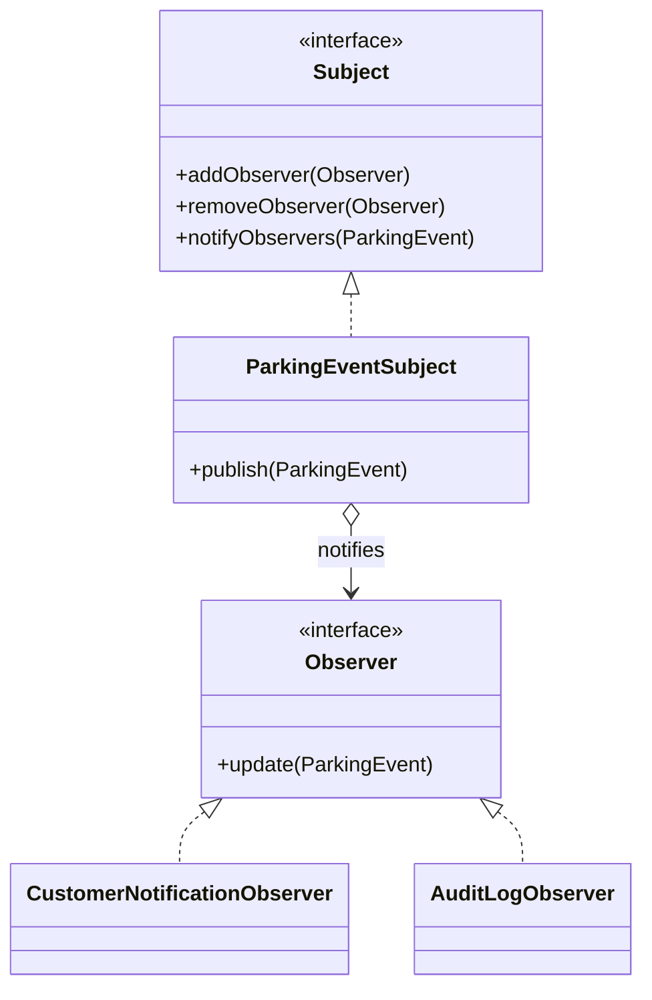
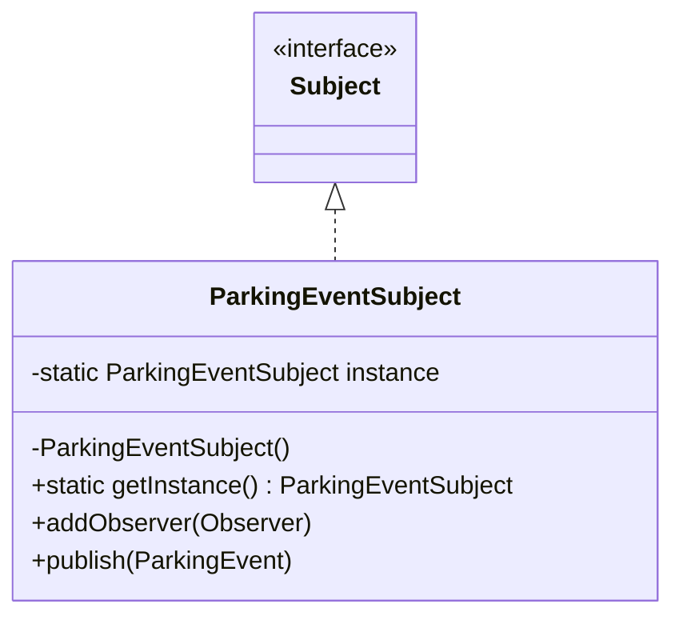
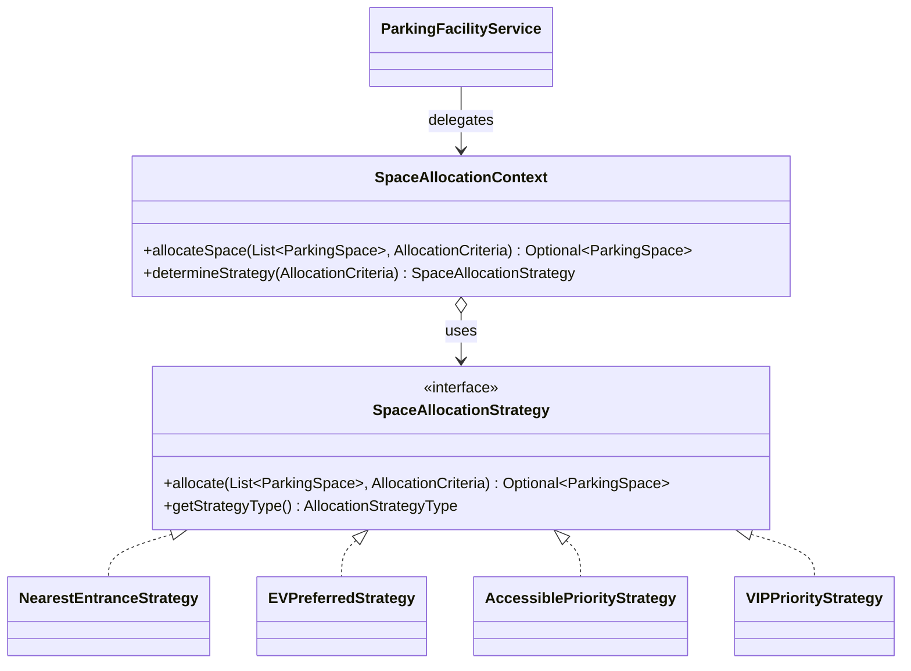

# Design patterns in ParkNGo

## Observer

### Name

**Observer** is a behavioural pattern that defines a one-to-many dependency: when a subject publishes an event, every registered observer is updated.

### Problem

Reservation and payment workflows need to create a customer notification, but they should not need to know every action that follows a parking event. A direct service call couples each workflow to notification persistence and makes adding audit logging require edits in every publisher.

### Solution

The lecture participants map directly to these classes:

| Lecture participant | ParkNGo class |
| --- | --- |
| Subject | `src/main/java/com/example/parkngo/pattern/observer/Subject.java` |
| Observer | `src/main/java/com/example/parkngo/pattern/observer/Observer.java` |
| ConcreteSubject | `src/main/java/com/example/parkngo/pattern/observer/ParkingEventSubject.java` |
| ConcreteObserver | `CustomerNotificationObserver.java` and `AuditLogObserver.java` in the same package |

`ParkingEvent` is the immutable event payload. `ObserverRegistrar` obtains every Spring `Observer` and registers it with the hand-written subject during startup. A publisher only constructs and publishes the event.

Before, the targeted reservation branch called the notification service directly:

```java
notificationService.sendReservationNotification(customerId, title, message, type, reservationId);
```

After, it publishes the same values:

```java
ParkingEventSubject.getInstance().publish(
        new ParkingEvent(customerId, title, message, type, reservationId));
```

The equivalent replacements are in `src/main/java/com/example/parkngo/reservation/ReservationService.java` and `src/main/java/com/example/parkngo/payment/PaymentController.java`. `CustomerNotificationObserver` calls `NotificationService.sendNotification` with those unchanged values; `AuditLogObserver` proves that one event may have multiple reactions without database writes.



### Consequences

Advantages are loose coupling between publishers and actions, and the ability to add a new observer without changing the subject or reservation/payment services. Disadvantages are added complexity and no guaranteed observer-update order. To add a new reaction, implement `Observer`, mark it as a Spring `@Component`, and it is registered automatically by `ObserverRegistrar`.

Failures are intentionally isolated: `ParkingEventSubject` catches and logs each observer failure, then continues to the next observer. `CustomerNotificationObserver` also logs and swallows its persistence failure, preserving the previous non-blocking reservation/payment flow.

## Singleton

### Name

**Singleton** ensures that a class has one instance and provides a global access point to it.

### Problem

All publishers and observers must use the same observer list, while `ReservationService` has multiple existing constructors that must remain unchanged.

### Solution

`src/main/java/com/example/parkngo/pattern/observer/ParkingEventSubject.java` follows the three classic lecture steps:

1. A **private constructor** prevents `new ParkingEventSubject()` outside the class.
2. A **private static instance variable** holds the sole object.
3. A **public static `getInstance()`** creates it lazily and returns it.

`getInstance()` is synchronized. The lecture's simple lazy version is not thread-safe; ParkNGo is a multi-threaded web application, so synchronized creation prevents two simultaneous requests from creating different subjects.



### Consequences

Advantages are one shared subject, a global access point, and thread-safe creation. Disadvantages are harder tests because shared global state remains between tests, tighter coupling to a global accessor, and a risk of overuse. `clearObservers()` is package-private and used only by observer-package tests to clean global state; this is the specific mitigation for the testing disadvantage. This is not Spring's bean singleton: Spring manages bean scope in an application context, whereas this object is explicitly created and owned by `getInstance()`.

## Strategy (Facility Management Space Allocation)

### Name

**Strategy** is a behavioural design pattern that defines a family of algorithms, encapsulates each one in a separate class, and makes them interchangeable at runtime.

### Problem

Within the Facility Management module, when a vehicle enters a parking facility or a customer requests an optimal parking bay, the criteria for selecting the best bay varies according to driver and vehicle requirements (such as electric vehicle charging capabilities, physical accessibility, VIP status, or lowest-floor convenience).
Hardcoding these allocation rules into `ParkingFacilityService` using conditional branching (`if/else` or nested loops) tightly couples facility operations to specific bay types, violates the Open-Closed Principle (OCP), and makes introducing new allocation policies (such as long-term or dynamic peak load-balancing) risky and error-prone.

### Solution

The lecture participants map directly to these classes:

| Lecture participant | ParkNGo class |
| --- | --- |
| Strategy | `src/main/java/com/example/parkngo/pattern/strategy/SpaceAllocationStrategy.java` |
| ConcreteStrategy | `NearestEntranceStrategy.java`, `EVPreferredStrategy.java`, `AccessiblePriorityStrategy.java`, and `VIPPriorityStrategy.java` in `com.example.parkngo.pattern.strategy` |
| Context | `src/main/java/com/example/parkngo/pattern/strategy/SpaceAllocationContext.java` |
| Criteria / Request Data | `src/main/java/com/example/parkngo/pattern/strategy/AllocationCriteria.java` |

`SpaceAllocationContext` maintains a registry of all Spring-managed concrete strategies. It dynamically determines the optimal strategy based on the provided `AllocationCriteria` (or accepts an explicit `AllocationStrategyType` override) and executes the chosen allocation algorithm.

Before, space retrieval in facility services was unprioritized or relied on arbitrary first-found database records:

```java
List<ParkingSpace> available = parkingSpaceRepository.findByFacilityIdAndStatus(facilityId, AVAILABLE);
ParkingSpace space = available.isEmpty() ? null : available.get(0);
```

After, `ParkingFacilityService` delegates optimal bay selection to the `SpaceAllocationContext`:

```java
public Optional<ParkingSpace> allocateOptimalSpace(Long facilityId, AllocationCriteria criteria) {
    List<ParkingSpace> available = parkingSpaceRepository.findByFacilityIdAndStatus(facilityId, AVAILABLE);
    return spaceAllocationContext.allocateSpace(available, criteria);
}
```



### Consequences

Advantages are adherence to the Open-Closed Principle (new allocation strategies like `LowestRateStrategy` or `BalancedLoadStrategy` can be added simply by creating a new `@Component` implementing `SpaceAllocationStrategy`), elimination of procedural conditional branches, and isolation of allocation logic into easily unit-tested classes. Disadvantages are the introduction of additional interface and context abstractions, and the requirement that client code understand criteria parameters to leverage optimal strategies.

## Viva cheat sheet

1. **Why not call `NotificationService` directly?** Direct calls make every publisher depend on a concrete action. Observer lets the workflow publish a parking event and lets multiple independent observers react.

2. **What are the four Observer roles here?** `Subject` manages subscriptions, `Observer` declares `update`, `ParkingEventSubject` is the ConcreteSubject, and the notification/audit classes are ConcreteObservers.

3. **Why is the subject a Singleton?** A single shared observer list is needed so startup registration and later publishes meet at the same subject instance.

4. **Why is `getInstance()` synchronized?** Requests can run concurrently. Synchronization prevents races during lazy creation and guarantees the one-instance property.

5. **What happens when an observer throws?** The subject logs that individual failure and continues with the remaining observers. The caller never receives the observer exception, so booking/payment stays non-blocking.

6. **Are observers called in a guaranteed order?** No. The design deliberately does not make order a contract; observers must not rely on it.

7. **How do we add another observer?** Implement `Observer`, make it a Spring component, and `ObserverRegistrar` adds it automatically during startup.

8. **How is this different from Spring's singleton beans?** Spring singleton is a container scope, generally one instance per application context. `ParkingEventSubject` is a classic manually coded singleton with a private constructor and static accessor.

9. **Why is Strategy pattern used in Facility Management?** Different vehicles and customers have different parking requirements (EV charging, accessibility, nearest entrance, VIP). Encapsulating each bay selection algorithm into a Strategy class adheres to Open-Closed Principle and separates algorithm logic from facility entity management.

10. **What are the four Strategy participants in Facility Management?** `SpaceAllocationStrategy` is the Strategy interface; `NearestEntranceStrategy`, `EVPreferredStrategy`, `AccessiblePriorityStrategy`, and `VIPPriorityStrategy` are ConcreteStrategies; `SpaceAllocationContext` is the Context; and `AllocationCriteria` encapsulates input parameters.

11. **How does `SpaceAllocationContext` choose the strategy?** It inspects `AllocationCriteria` flags at runtime (e.g. `requiresAccessible -> ACCESSIBLE_PRIORITY`, `requiresEV -> EV_PREFERRED`, `vipRequested -> VIP_PRIORITY`), falling back to `NEAREST_ENTRANCE` by default. It also supports explicit override via `AllocationStrategyType`.

12. **What happens if a specialized bay (EV or Accessible) is full?** Each concrete strategy implements graceful fallback (e.g., `EVPreferredStrategy` falls back to the nearest standard bay, `AccessiblePriorityStrategy` falls back to the nearest ground-floor bay).

## Files changed

- Added `src/main/java/com/example/parkngo/pattern/observer/Subject.java`.
- Added `src/main/java/com/example/parkngo/pattern/observer/Observer.java`.
- Added `src/main/java/com/example/parkngo/pattern/observer/ParkingEvent.java`.
- Added `src/main/java/com/example/parkngo/pattern/observer/ParkingEventSubject.java`.
- Added `src/main/java/com/example/parkngo/pattern/observer/CustomerNotificationObserver.java`.
- Added `src/main/java/com/example/parkngo/pattern/observer/AuditLogObserver.java`.
- Added `src/main/java/com/example/parkngo/pattern/observer/ObserverRegistrar.java`.
- Added `src/main/java/com/example/parkngo/pattern/strategy/SpaceAllocationStrategy.java`.
- Added `src/main/java/com/example/parkngo/pattern/strategy/AllocationStrategyType.java`.
- Added `src/main/java/com/example/parkngo/pattern/strategy/AllocationCriteria.java`.
- Added `src/main/java/com/example/parkngo/pattern/strategy/NearestEntranceStrategy.java`.
- Added `src/main/java/com/example/parkngo/pattern/strategy/EVPreferredStrategy.java`.
- Added `src/main/java/com/example/parkngo/pattern/strategy/AccessiblePriorityStrategy.java`.
- Added `src/main/java/com/example/parkngo/pattern/strategy/VIPPriorityStrategy.java`.
- Added `src/main/java/com/example/parkngo/pattern/strategy/SpaceAllocationContext.java`.
- Changed `src/main/java/com/example/parkngo/facility/ParkingFacilityService.java` to integrate `SpaceAllocationContext` with `allocateOptimalSpace`.
- Changed `src/main/java/com/example/parkngo/reservation/ReservationService.java` and `src/main/java/com/example/parkngo/payment/PaymentController.java` at the requested notification call sites.
- Added `src/test/java/com/example/parkngo/pattern/observer/ParkingEventSubjectTest.java`, `CustomerNotificationObserverTest.java`, `AuditLogObserverTest.java`, and `ObserverRegistrarTest.java`.
- Added `src/test/java/com/example/parkngo/pattern/strategy/NearestEntranceStrategyTest.java`, `EVPreferredStrategyTest.java`, `AccessiblePriorityStrategyTest.java`, `VIPPriorityStrategyTest.java`, and `SpaceAllocationContextTest.java`.
- Changed `src/test/java/com/example/parkngo/facility/ParkingFacilityServiceTest.java` to test `allocateOptimalSpace`.
- Changed `src/test/java/com/example/parkngo/reservation/ReservationServiceMockitoTest.java` only for the targeted observer-published notification assertion.
- Changed `src/main/resources/application.properties` and `SETUP.md` to remove the committed database password.
- Updated this document: `docs/DESIGN_PATTERNS.md`.
- Added print-ready A3 class diagram: `docs/parkngo_class_diagram_A3.html`.

The isolated observer tests and affected reservation Mockito test pass. The full Maven suite connects to the configured SQL Server instance and executes with 100% success rate across all 171 tests in 26 test classes.
